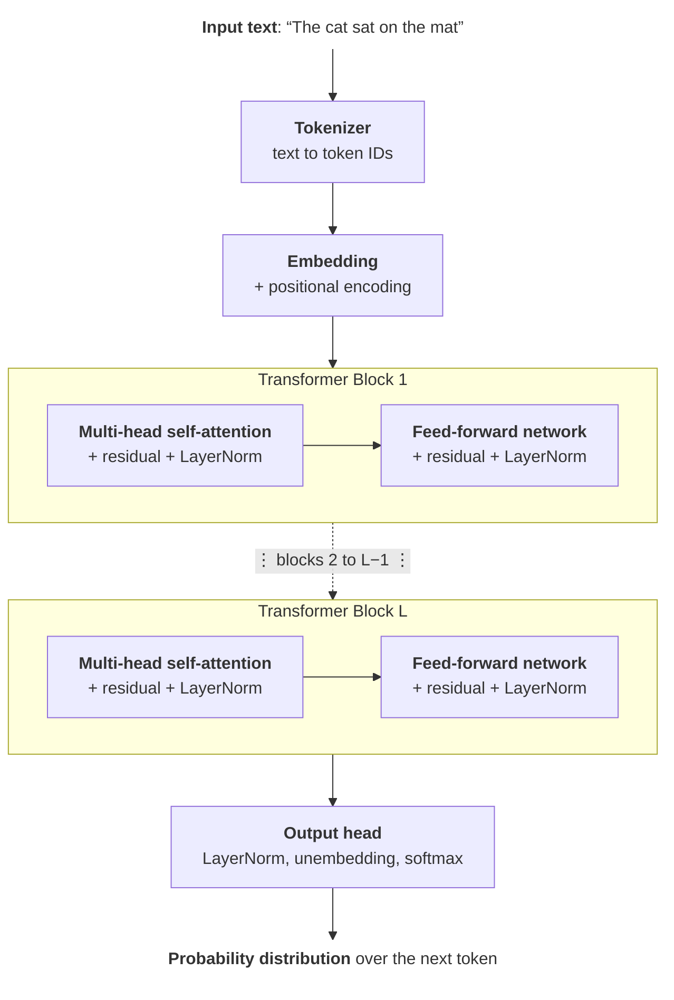

# Part I — Foundations

## 1. Why transformers replaced recurrent networks

Before 2017, the dominant architectures for sequence modeling were Recurrent Neural Networks (RNNs) and their gated variants — most prominently the Long Short-Term Memory (LSTM) cell and the Gated Recurrent Unit (GRU). These networks process a sequence one token at a time, maintaining a hidden state that summarizes everything seen so far. Each step is a function of the previous hidden state and the current input.

This sequential dependency has two serious consequences for training.

**Limited parallelism.** To compute the hidden state at position $t$, you must first compute the state at position $t-1$. The forward pass is therefore inherently sequential along the time axis, and a GPU cannot parallelize across positions in a single sequence. As sequences grow longer, training time grows linearly with sequence length, even with unlimited hardware.

**Vanishing and exploding gradients.** During backpropagation through time, gradients are repeatedly multiplied by the recurrent weight matrix. Without careful gating (which is what LSTM cells provide), these gradients either shrink toward zero or explode, making it hard for the network to learn dependencies between tokens far apart in the sequence.

The 2017 paper *Attention Is All You Need* ([Vaswani et al., 2017](./14-appendix-a-further-reading.md#vaswani-et-al-2017)) proposed an architecture that abandons recurrence entirely. Instead of building up a hidden state token by token, every position can attend directly to every other position in a single layer. The consequences are dramatic:

- **The forward pass parallelizes across positions.** Every token's representation depends only on the previous layer's outputs, never on another token's final representation. A single matrix multiplication produces the attention output for the entire sequence at once.
- **The path length between any two positions is constant.** A signal at position 1 reaches position 1000 in one layer, not 999 recurrent steps. Long-range dependencies are no harder to learn than short-range ones.
- **The architecture is purely linear-algebraic.** Every operation is a matrix multiply, an addition, an element-wise nonlinearity or a normalization. GPUs are very good at these.

> **Note.** The original paper compared its transformer against the best available recurrent and convolutional models for English-to-German and English-to-French translation. The transformer achieved state-of-the-art BLEU scores while requiring a small fraction of the training time. Within a few years it had become the foundation of essentially every large-scale language model, as well as state-of-the-art models in vision, speech, biology and reinforcement learning.

## 2. Mathematical prerequisites

The transformer uses only a handful of mathematical operations, but uses them at scale. Each is reviewed briefly here so that the parts that follow can move quickly.

### Matrix multiplication

If $\mathbf{A} \in \mathbb{R}^{m \times k}$ and $\mathbf{B} \in \mathbb{R}^{k \times n}$, the product $\mathbf{C} = \mathbf{A}\mathbf{B}$ is the matrix in $\mathbb{R}^{m \times n}$ whose entries are dot products of rows of $\mathbf{A}$ with columns of $\mathbf{B}$:

$$C_{ij} = \sum_{p=1}^{k} A_{ip}\, B_{pj}$$

Two conventions are worth internalizing. First, the inner dimension must match: $\mathbf{A}$ has $k$ columns, so $\mathbf{B}$ must have $k$ rows. Second, the operation is associative, $(\mathbf{A}\mathbf{B})\mathbf{C} = \mathbf{A}(\mathbf{B}\mathbf{C})$, but not commutative: $\mathbf{A}\mathbf{B} \neq \mathbf{B}\mathbf{A}$ in general. In a transformer you will see chains like $\mathbf{X}\mathbf{W}_Q\mathbf{K}^\top$. Where you place the parentheses changes nothing mathematically, but it can change the computational cost.

### The dot product as similarity

For two vectors $\mathbf{a}, \mathbf{b} \in \mathbb{R}^d$, their dot product is

$$\mathbf{a} \cdot \mathbf{b} = \sum_{i=1}^{d} a_i b_i = \lVert\mathbf{a}\rVert \, \lVert\mathbf{b}\rVert \cos\theta$$

where $\theta$ is the angle between them and $\lVert\cdot\rVert$ denotes Euclidean length. The dot product is large and positive when the vectors point in similar directions, zero when they are orthogonal, and negative when they point in opposite directions.

This is the central geometric fact behind attention: a query's dot product with a key measures how similar the two vectors are in the learned representation space ([Weng, 2018](./14-appendix-a-further-reading.md#weng-2018)).

### The softmax function

Given a vector $\mathbf{z} \in \mathbb{R}^n$ of real-valued "scores", the softmax produces a vector of probabilities — non-negative, and summing to one:

$$\operatorname{softmax}(\mathbf{z})_i = \frac{\exp(z_i)}{\sum_{j=1}^{n} \exp(z_j)}$$

Three properties matter for what follows.

1. **It is monotonic.** A larger $z_i$ produces a larger $\operatorname{softmax}(\mathbf{z})_i$.
2. **It is translation-invariant.** Adding the same constant to every $z_i$ does not change the output: the exponentials all scale by the same factor, and it cancels in the ratio. This is the basis of the standard numerical-stability trick: subtract $\max(\mathbf{z})$ from every $z_i$ before exponentiating, to avoid overflow.
3. **It is sensitive to the scale of its inputs.** Multiplying $\mathbf{z}$ by a large constant pushes the output toward a one-hot vector; multiplying by a small constant pushes it toward a uniform distribution. Part III shows that this property motivates the $1/\sqrt{d_k}$ scaling factor in attention.

### Layer-wise transformations

A standard fully connected (linear) layer applies an affine transformation to its input:

$$\mathbf{y} = \mathbf{x}\mathbf{W} + \mathbf{b}$$

where $\mathbf{x} \in \mathbb{R}^{1 \times d_{\text{in}}}$, $\mathbf{W} \in \mathbb{R}^{d_{\text{in}} \times d_{\text{out}}}$, $\mathbf{b} \in \mathbb{R}^{1 \times d_{\text{out}}}$ and $\mathbf{y} \in \mathbb{R}^{1 \times d_{\text{out}}}$. With the row-vector convention, $\mathbf{x}$ is on the left of $\mathbf{W}$.

Modern transformers apply linear transformations everywhere, and many of them drop the bias term $\mathbf{b}$. PaLM reports that omitting biases increased training stability at large scale ([Chowdhery et al., 2022](./14-appendix-a-further-reading.md#chowdhery-et-al-2022)), although the original Transformer's feed-forward layers did use biases ([Vaswani et al., 2017](./14-appendix-a-further-reading.md#vaswani-et-al-2017)).

### Element-wise nonlinearities

Any function applied independently to each scalar entry of a tensor is element-wise. The transformer's feed-forward network uses one of several such functions (ReLU, GELU, Swish), which Part VI examines.

## 3. The high-level architecture

The original transformer is an encoder–decoder model designed for sequence-to-sequence tasks such as translation. The encoder reads the source sentence and produces a representation; the decoder consumes that representation and generates the target sentence one token at a time. Both halves are built from identical building blocks: multi-head attention and position-wise feed-forward networks, each wrapped with a residual connection and layer normalization.

Modern large language models — GPT, Llama, Mistral, Qwen, DeepSeek — keep only the decoder half and use it on its own, a configuration called *decoder-only*. Part X covers the encoder–decoder design. Through Part IX, this guide focuses on the decoder-only model, which is both simpler and more relevant to current systems.

### Tokenizer

Splits the input text into subword pieces and maps each piece to an integer ID from a fixed vocabulary of size $V$. It sits outside the transformer proper: the network only ever sees the IDs, never the raw text.

### Embedding module

Looks up each token ID as a row of a learned embedding matrix $\mathbf{E} \in \mathbb{R}^{V \times d_{\text{model}}}$ and gives every token a sense of its position, because attention by itself cannot tell the order of tokens. The result, $\mathbf{X} \in \mathbb{R}^{n \times d_{\text{model}}}$, is what flows into the first block.

### Multi-head attention module

Lets every token look at the other tokens and pull in what is relevant to it, by comparing queries with keys and taking a weighted sum of values. Several heads do this in parallel, each free to focus on a different kind of relationship, and a decoder-only model masks the future so that a token attends only to earlier ones.

### Feed-forward network module

A small two-layer (Multilayer Perceptron) network applied to each token independently: it expands the representation to a wider inner dimension $d_{\text{ff}}$, applies a nonlinearity, and compresses it back to $d_{\text{model}}$. Most of a block's parameters live here.

### Output head

A final layer normalization, then a linear projection (the unembedding) from $d_{\text{model}}$ to the vocabulary size $V$, and a softmax that turns the resulting scores into a probability distribution over the next token.

### The residual stream

A useful mental model — popularized by mechanistic interpretability research, and aligned with the residual-connection design of [He et al. (2015)](./14-appendix-a-further-reading.md#he-et-al-2015) — is to think of the matrix flowing through the network as a *residual stream*. Every layer reads from this stream, computes something based on it, and adds the result back. The stream has the same shape, $n \times d_{\text{model}}$, all the way through the model. Parts III to VII show how attention layers and feed-forward layers each contribute to it.

### The layer norm

Rescales each token's vector to zero mean and unit variance across its $d_{\text{model}}$ features, then applies a learned scale and shift, which keeps the values flowing through many stacked layers in a stable range. Each block uses it with both its attention and its feed-forward sub-layer, and the output head applies one more at the end.

### A bird's-eye view

*Figure: Decoder-only data flow. The block repeats $L$ times (32 in Llama 3 8B, 96 in GPT-3 175B).*
