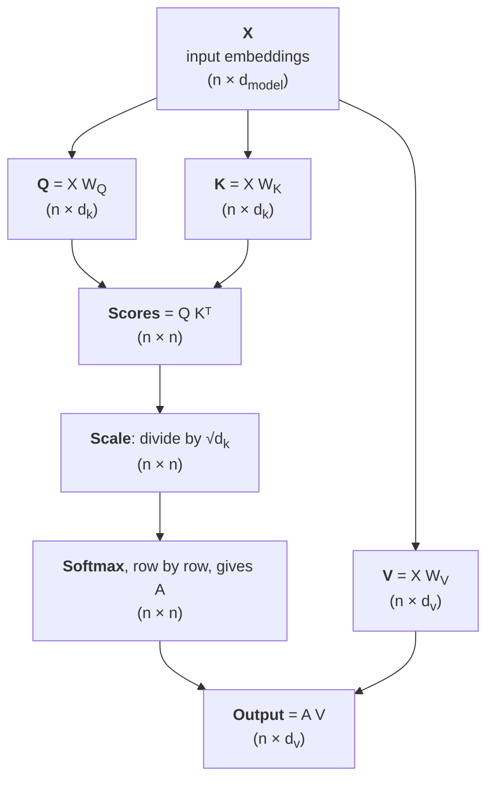

# Part III — Scaled dot-product attention

## 10. The intuition: queries, keys and values

Attention is the central mechanism of the transformer. Normalization, residual connections and feed-forward networks make the model trainable and expressive, and the embedding and unembedding layers handle the boundary with token IDs, but attention is what lets information at one position influence the representation at another ([Vaswani et al., 2017](./14-appendix-a-further-reading.md#vaswani-et-al-2017)).

The mechanism is usually explained with a lookup metaphor ([Alammar, 2018](./14-appendix-a-further-reading.md#alammar-2018)). Imagine each position in the sequence performing a lookup against every other position. The lookup has three components:

- **The query ($\mathbf{q}$).** Each position asks a question. In an illustrative example, a noun like "creature" might ask: "Are there any adjectives in front of me?" The question is encoded as a vector, the query vector for that position.
- **The key ($\mathbf{k}$).** Every position also advertises what it offers. The adjective "fluffy" might broadcast: "I am an adjective." This advertisement is also a vector, the key vector for that position.
- **The value ($\mathbf{v}$).** Once we have decided which positions a query matches, we need the actual information to retrieve. That information is the value vector at each position. If the query from "creature" matches the key from "fluffy", the value vector from "fluffy" carries the content ("fluffy-ness") that gets pulled into the creature's representation.

The mathematics turns this metaphor into matrix operations. Matching between queries and keys is done with dot products: when two vectors point in similar directions in the learned space, their dot product is large, signalling that they are compatible. The compatibility scores are turned into weights with a softmax, and the weights are used to take a weighted sum of the value vectors.

> **Note.** $\mathbf{Q}$, $\mathbf{K}$ and $\mathbf{V}$ are not three separate inputs. They are all derived from the same input $\mathbf{X}$ by linear projection. The same input vector serves three different roles depending on which matrix it is projected through. Section 11 shows exactly how.

### The complete formula

The whole computation is a single formula ([Vaswani et al., 2017](./14-appendix-a-further-reading.md#vaswani-et-al-2017)):

$$\operatorname{Attention}(\mathbf{Q}, \mathbf{K}, \mathbf{V}) = \operatorname{softmax}\!\left(\frac{\mathbf{Q}\mathbf{K}^\top}{\sqrt{d_k}}\right)\mathbf{V}$$

Read it from the inside out:

- $\mathbf{Q}\mathbf{K}^\top$ computes the similarity between every query and every key, a matrix of scores.
- Dividing by $\sqrt{d_k}$ rescales the scores so that the softmax does not saturate.
- The softmax converts each row of scores into a probability distribution over positions.
- Multiplying by $\mathbf{V}$ takes, for each query, a weighted average of the value vectors.

The rest of this part unpacks each step, with the matrix shapes laid out explicitly so you can follow exactly what happens to the data. Everything here describes a single attention head; Part IV runs several in parallel, and Part V adds the causal mask that a decoder-only model needs.

## 11. Building Q, K and V by linear projection

We start with the input $\mathbf{X} \in \mathbb{R}^{n \times d_{\text{model}}}$: a matrix whose $n$ rows are the token embeddings for the $n$ tokens in our sequence. To produce queries, keys and values, we apply three separate linear projections, that is, three matrix multiplications by trainable weight matrices ([Vaswani et al., 2017](./14-appendix-a-further-reading.md#vaswani-et-al-2017)):

$$\mathbf{Q} = \mathbf{X}\mathbf{W}_Q, \qquad \mathbf{K} = \mathbf{X}\mathbf{W}_K, \qquad \mathbf{V} = \mathbf{X}\mathbf{W}_V$$

The original paper sets $d_k = d_v = d_{\text{model}} / h$, where $h$ is the number of attention heads (Part IV). With $h = 8$ and $d_{\text{model}} = 512$, that gives $d_k = d_v = 64$ ([Vaswani et al., 2017](./14-appendix-a-further-reading.md#vaswani-et-al-2017)). Queries and keys must share the dimension $d_k$, because they are compared with a dot product; the value dimension $d_v$ is a separate choice, but the standard one is to make them equal, which this guide does unless noted otherwise.

The shapes are:

::: grid
| Tensor | Shape | Role |
|---|---|---|
| $\mathbf{X}$ | $n \times d_{\text{model}}$ | input, one row per token |
| $\mathbf{W}_Q$ | $d_{\text{model}} \times d_k$ | learned query projection |
| $\mathbf{W}_K$ | $d_{\text{model}} \times d_k$ | learned key projection |
| $\mathbf{W}_V$ | $d_{\text{model}} \times d_v$ | learned value projection |
| $\mathbf{Q}$ | $n \times d_k$ | queries, one row per token |
| $\mathbf{K}$ | $n \times d_k$ | keys, one row per token |
| $\mathbf{V}$ | $n \times d_v$ | values, one row per token |
:::

### Why three projections instead of one?

We could have used $\mathbf{X}$ directly with no projection, since the dot product of one input vector with another would still give a similarity score. The projections give the model crucial flexibility: they let the same input play three different roles. What the query vector encodes is the question this position is asking. What the key vector encodes is what this position offers for matching. What the value vector encodes is the information this position contributes if it is matched. These three quantities are different, so they need different learned transformations. The model can learn, for example, to project a noun's embedding into a query that says "I want an adjective", while the same noun's key says "I am a noun" and its value says "I am a creature".

### A worked example: computing Q

Take the $\mathbf{X}$ from Section 5 ($3 \times 4$), and a small query matrix $\mathbf{W}_Q$ ($4 \times 3$, so $d_k = 3$) with simple values to keep the arithmetic tractable:

$$\mathbf{X} = \begin{bmatrix}
0.30 & 0.40 & 0.10 & 0.20 \\
0.40 & 0.20 & 0.10 & 0.50 \\
0.50 & 0.10 & 0.20 & 0.30
\end{bmatrix}, \qquad
\mathbf{W}_Q = \begin{bmatrix}
1 & 0 & 0 \\
0 & 1 & 0 \\
0 & 0 & 1 \\
1 & 0 & 1
\end{bmatrix}$$

Each entry of $\mathbf{Q} = \mathbf{X}\mathbf{W}_Q$ is the dot product of a row of $\mathbf{X}$ with a column of $\mathbf{W}_Q$. For row 0:

$$\begin{aligned}
\mathbf{Q}[0,0] &= 0.30 \cdot 1 + 0.40 \cdot 0 + 0.10 \cdot 0 + 0.20 \cdot 1 = 0.50 \\
\mathbf{Q}[0,1] &= 0.30 \cdot 0 + 0.40 \cdot 1 + 0.10 \cdot 0 + 0.20 \cdot 0 = 0.40 \\
\mathbf{Q}[0,2] &= 0.30 \cdot 0 + 0.40 \cdot 0 + 0.10 \cdot 1 + 0.20 \cdot 1 = 0.30
\end{aligned}$$

The same pattern for rows 1 and 2 gives

$$\mathbf{Q} = \begin{bmatrix}
0.50 & 0.40 & 0.30 \\
0.90 & 0.20 & 0.60 \\
0.80 & 0.10 & 0.50
\end{bmatrix}$$

$\mathbf{K}$ and $\mathbf{V}$ would be computed the same way from their own weight matrices. To keep the example small, we do not pick $\mathbf{W}_K$ and $\mathbf{W}_V$; we simply assume these values for $\mathbf{K}$ and $\mathbf{V}$, chosen to give clean attention weights:

$$\mathbf{K} = \begin{bmatrix}
0.40 & 0.10 & 0.50 \\
0.70 & 0.30 & 0.20 \\
0.20 & 0.50 & 0.40
\end{bmatrix}, \qquad
\mathbf{V} = \begin{bmatrix}
1 & 0 & 0 \\
0 & 1 & 0 \\
0 & 0 & 1
\end{bmatrix}$$

We use a deliberately simple $\mathbf{V}$, where each row is a one-hot vector. This will make it obvious, when we compute the final output, which positions each query attended to.

## 12. The dot-product similarity matrix

Now we compute the similarity between every query and every key. With $\mathbf{Q}, \mathbf{K} \in \mathbb{R}^{n \times d_k}$, the product $\mathbf{Q}\mathbf{K}^\top$ has shape $n \times n$, and entry $(i, j)$ is the dot product of query $i$ with key $j$:

$$(\mathbf{Q}\mathbf{K}^\top)_{ij} = \mathbf{Q}_{i,:} \cdot \mathbf{K}_{j,:} = \sum_{p=1}^{d_k} Q_{ip} K_{jp}$$

Row $i$ of the result tells you how strongly query $i$ matches each of the $n$ keys. The diagonal is the score of each query against its own key; the off-diagonal entries are the cross-position scores.

Continuing the example, $\mathbf{K}^\top$ is

$$\mathbf{K}^\top = \begin{bmatrix}
0.40 & 0.70 & 0.20 \\
0.10 & 0.30 & 0.50 \\
0.50 & 0.20 & 0.40
\end{bmatrix}$$

and the first row of $\mathbf{Q}\mathbf{K}^\top$ is

$$\begin{aligned}
(\mathbf{Q}\mathbf{K}^\top)[0,0] &= 0.50 \cdot 0.40 + 0.40 \cdot 0.10 + 0.30 \cdot 0.50 = 0.39 \\
(\mathbf{Q}\mathbf{K}^\top)[0,1] &= 0.50 \cdot 0.70 + 0.40 \cdot 0.30 + 0.30 \cdot 0.20 = 0.53 \\
(\mathbf{Q}\mathbf{K}^\top)[0,2] &= 0.50 \cdot 0.20 + 0.40 \cdot 0.50 + 0.30 \cdot 0.40 = 0.42
\end{aligned}$$

Doing the same for rows 1 and 2 gives the full matrix, where row $i$ is query $i$ and column $j$ is key $j$:

$$\mathbf{Q}\mathbf{K}^\top = \begin{bmatrix}
0.39 & 0.53 & 0.42 \\
0.68 & 0.81 & 0.52 \\
0.58 & 0.69 & 0.41
\end{bmatrix}$$

Looking at row 0: query 0 has the highest affinity with key 1 (score 0.53), then key 2 (0.42), then key 0 (0.39). These are raw scores: they have not been scaled or normalized yet.

### Computational cost

The matrix $\mathbf{Q}\mathbf{K}^\top$ has $n^2$ entries, each a dot product over $d_k$ dimensions, so the cost is $O(n^2 \cdot d_k)$ ([Vaswani et al., 2017](./14-appendix-a-further-reading.md#vaswani-et-al-2017)). This is the much-discussed quadratic complexity of attention: doubling the sequence length quadruples the cost of this operation, and for long contexts the $n^2$ term grows to dominate the cost of attention.

## 13. Why the $1/\sqrt{d_k}$ scaling factor

Before applying the softmax, we divide every entry of $\mathbf{Q}\mathbf{K}^\top$ by $\sqrt{d_k}$. This scaling is not cosmetic: without it, training gets harder as $d_k$ grows. Vaswani et al. report that for larger $d_k$, unscaled dot-product attention performs worse than additive attention, and suspect the cause is that the dot products grow large and push the softmax into regions where its gradients are extremely small ([Vaswani et al., 2017](./14-appendix-a-further-reading.md#vaswani-et-al-2017)). Their argument for why the dot products grow is a short calculation about variance. In their words: assume that the components of $\mathbf{q}$ and $\mathbf{k}$ are independent random variables with mean 0 and variance 1; then their dot product, $\mathbf{q} \cdot \mathbf{k} = \sum_{i=1}^{d_k} q_i k_i$, has mean 0 and variance $d_k$.

The reasoning, step by step: if $q_i$ and $k_i$ are independent with mean 0 and variance 1, their product $q_i k_i$ has mean 0 and variance 1 too. Summing $d_k$ independent terms of variance 1 gives a sum with variance $d_k$, and so a standard deviation of $\sqrt{d_k}$. The assumption is an idealisation, roughly what one expects of well-initialized projections of normalized inputs; it describes the typical size of a score and is not a guarantee.

For $d_k = 64$ that standard deviation is $8$; for $d_k = 128$ it is about $11.3$. Dot products this large are a problem for softmax. As Part I noted, softmax is sensitive to the scale of its inputs: when they are large, the output becomes nearly one-hot, almost all the probability concentrates on the single largest entry, and the gradient with respect to the other entries becomes very small. A softmax that has already collapsed gives the model little to learn from.

Dividing by $\sqrt{d_k}$ rescales the dot products to have standard deviation 1, whatever $d_k$ is. This keeps the softmax in a regime where its outputs are spread across positions and its gradient is well-behaved.

> **Note.** The asymmetry is deliberate: we divide by $\sqrt{d_k}$, not by $d_k$. The factor we need is the standard deviation of the dot product, which grows with the *square root* of the vector dimension, not with the dimension itself. The same square-root argument for keeping variances constant appears in other places in deep learning, such as weight-initialization schemes.

### Applying the scaling

In the worked example $d_k = 3$, so we divide every entry of $\mathbf{Q}\mathbf{K}^\top$ by $\sqrt{3} \approx 1.732$:

$$\frac{\mathbf{Q}\mathbf{K}^\top}{\sqrt{d_k}} \approx \begin{bmatrix}
0.225 & 0.306 & 0.242 \\
0.393 & 0.468 & 0.300 \\
0.335 & 0.398 & 0.237
\end{bmatrix}$$

In this toy example the difference is small, since $\sqrt{d_k}$ is only 1.732. In a real model with $d_k = 64$ the scores shrink by a factor of 8, which matters enormously to the softmax.

## 14. Softmax: from scores to weights

We now have a matrix of scaled similarity scores. Each row tells us how strongly that query matches each key, on an unbounded real-valued scale. To use these scores as weights in an average, we need them non-negative and summing to one across each row, which is exactly what softmax does. It is applied row by row. For row $i$:

$$A_{ij} = \frac{\exp(s_{ij})}{\sum_{k=1}^{n} \exp(s_{ik})}, \qquad s_{ij} = \frac{(\mathbf{Q}\mathbf{K}^\top)_{ij}}{\sqrt{d_k}}$$

After softmax, each row of $\mathbf{A}$ is a probability distribution over the $n$ positions: $A_{ij}$ is the fraction of attention that query $i$ places on position $j$.

Continuing the example, for row 0:

$$\begin{aligned}
\text{scaled scores:} &\quad [0.225,\ 0.306,\ 0.242] \\
\text{exponentials:} &\quad [1.253,\ 1.358,\ 1.274] \\
\text{sum:} &\quad 3.885 \\
\text{softmax:} &\quad [0.322,\ 0.350,\ 0.328]
\end{aligned}$$

Applying the same steps to every row gives the attention weights:

$$\mathbf{A} = \operatorname{softmax}\!\left(\frac{\mathbf{Q}\mathbf{K}^\top}{\sqrt{d_k}}\right) \approx \begin{bmatrix}
0.322 & 0.350 & 0.328 \\
0.334 & 0.361 & 0.305 \\
0.336 & 0.359 & 0.305
\end{bmatrix}$$

Each row sums to 1 (row 0: $0.322 + 0.350 + 0.328 = 1.000$). These distributions are nearly flat, because the example is small and contrived. In trained models, attention rows are often much sharper, with most of the weight on a few positions; Vaswani et al. show heads whose attention is "very sharp" for particular words in the visualizations in their appendix ([Vaswani et al., 2017](./14-appendix-a-further-reading.md#vaswani-et-al-2017)).

## 15. The weighted sum over values

The final step is the weighted average. We multiply the attention weight matrix $\mathbf{A}$ (shape $n \times n$) by the value matrix $\mathbf{V}$ (shape $n \times d_v$):

$$\text{Output} = \mathbf{A}\mathbf{V} \in \mathbb{R}^{n \times d_v}$$

Row $i$ of the output is a weighted sum of the value vectors:

$$\text{Output}_{i,:} = \sum_{j=1}^{n} A_{ij}\, \mathbf{V}_{j,:}$$

This is the moment when information from other positions flows into position $i$. The output at position $i$ is a mixture of every position's value, weighted by how much attention $i$ pays to each ([Alammar, 2018](./14-appendix-a-further-reading.md#alammar-2018)).

In the example, with one-hot rows in $\mathbf{V}$:

$$\begin{aligned}
\text{Output}[0] &= 0.322 \cdot \mathbf{V}[0] + 0.350 \cdot \mathbf{V}[1] + 0.328 \cdot \mathbf{V}[2] \\
&= 0.322 \cdot [1, 0, 0] + 0.350 \cdot [0, 1, 0] + 0.328 \cdot [0, 0, 1] \\
&= [0.322,\ 0.350,\ 0.328]
\end{aligned}$$

and for all three positions

$$\mathbf{A}\mathbf{V} \approx \begin{bmatrix}
0.322 & 0.350 & 0.328 \\
0.334 & 0.361 & 0.305 \\
0.336 & 0.359 & 0.305
\end{bmatrix}$$

Because $\mathbf{V}$ is the $3 \times 3$ identity matrix, the output rows are just copies of the rows of $\mathbf{A}$. In a real model $\mathbf{V}$ holds rich learned representations, and the output mixes those representations according to the attention pattern.

## 16. The whole computation at a glance

Putting the pipeline together: for a single attention head over a sequence of $n$ tokens, the data goes through the steps below, and the shapes at each stage are the ones used in the worked example ($n = 3$, $d_{\text{model}} = 4$, $d_k = d_v = 3$).

*Figure: Shapes through a single attention head. Queries and keys meet in an $n \times n$ score matrix; the values are only brought in at the last step, weighted by the softmax of those scores.*

This is a single-head computation. In a real transformer the same computation is repeated for several heads in parallel, each with its own $\mathbf{W}_Q$, $\mathbf{W}_K$ and $\mathbf{W}_V$ projections, which is the subject of the next part.
