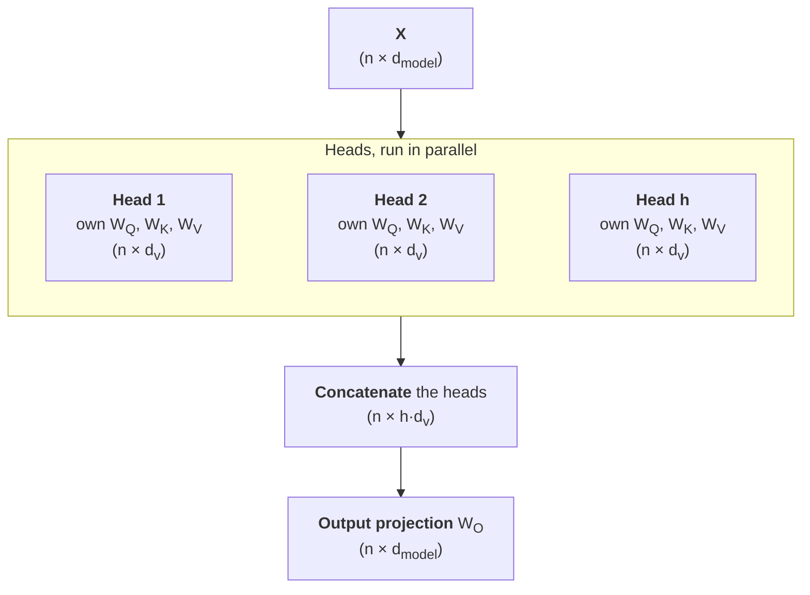

# Part IV — Multi-head attention

## 17. Why multiple heads

A single scaled dot-product attention computation produces one set of attention weights per query: one pattern of "which positions matter to me". But the model may need to track many different relationships at once. Within the same sentence it might need to attend to:

- the immediately preceding word, for local syntactic patterns;
- the subject of the sentence, for verb agreement;
- a much earlier mention of an entity, for coreference ("the cat … it");
- a parallel structure on the other side of a comma.

A single head, with a single set of $\mathbf{Q}$, $\mathbf{K}$, $\mathbf{V}$ projections, would have to blend all of these signals into one output. That is a hard compromise: the head can attend locally or attend to the subject, but it has to split its weight between them.

Multi-head attention addresses this by running several attention heads in parallel ([Vaswani et al., 2017](./14-appendix-a-further-reading.md#vaswani-et-al-2017)). Each head has its own projection matrices and produces its own attention output; the outputs of all heads are then concatenated and projected back to the dimension of the residual stream. In the original paper's words: "Multi-head attention allows the model to jointly attend to information from different representation subspaces at different positions. With a single attention head, averaging inhibits this."

Analyses of trained models find heads with distinct roles, though not every head has a clean one. In BERT, some heads put most of their attention on the previous or the next token ([Clark et al., 2019](./14-appendix-a-further-reading.md#clark-et-al-2019)). In a translation model's encoder, a handful of positional, syntactic and rare-word heads do most of the work, and the rest can be pruned with little loss ([Voita et al., 2019](./14-appendix-a-further-reading.md#voita-et-al-2019)). In language models, *induction heads* complete repeated patterns: if the text earlier contained "Harry Potter" and the current token is "Harry" again, an induction head attends to the token that followed the earlier "Harry" and boosts "Potter" as the prediction ([Olsson et al., 2022](./14-appendix-a-further-reading.md#olsson-et-al-2022)).

## 18. The matrix mechanics of head splitting

There are two equivalent ways to describe multi-head attention. The conceptually clean version runs $h$ separate single-head attention computations, each with its own projection matrices, then combines them. The efficient version packs all $h$ heads' projections into single large matrices and uses reshape operations to separate the heads. We present both, because the first is easier to understand and the second is how implementations work ([Alammar, 2018](./14-appendix-a-further-reading.md#alammar-2018)).

### Conceptual view: $h$ independent heads

For each head $i \in \{1, \dots, h\}$ there are separate weight matrices

$$\mathbf{W}_Q^{(i)},\ \mathbf{W}_K^{(i)} \in \mathbb{R}^{d_{\text{model}} \times d_k}, \qquad \mathbf{W}_V^{(i)} \in \mathbb{R}^{d_{\text{model}} \times d_v}$$

and each head computes its own attention output, exactly as in Part III:

$$\mathbf{Q}^{(i)} = \mathbf{X}\mathbf{W}_Q^{(i)}, \quad \mathbf{K}^{(i)} = \mathbf{X}\mathbf{W}_K^{(i)}, \quad \mathbf{V}^{(i)} = \mathbf{X}\mathbf{W}_V^{(i)}$$

$$\text{head}_i = \operatorname{softmax}\!\left(\frac{\mathbf{Q}^{(i)} \mathbf{K}^{(i)\top}}{\sqrt{d_k}}\right)\mathbf{V}^{(i)}$$

Each $\text{head}_i$ has shape $n \times d_v$. The $h$ heads run independently: they share no parameters and no intermediate state. Their outputs are then concatenated along the feature axis,

$$\text{concat} = [\,\text{head}_1,\ \text{head}_2,\ \dots,\ \text{head}_h\,] \in \mathbb{R}^{n \times (h \cdot d_v)}$$

and a final linear projection by $\mathbf{W}_O$ gives the result:

$$\operatorname{MultiHead}(\mathbf{X}) = \text{concat} \cdot \mathbf{W}_O, \qquad \mathbf{W}_O \in \mathbb{R}^{(h \cdot d_v) \times d_{\text{model}}}$$

The original paper sets $d_k = d_v = d_{\text{model}} / h$, so concatenating $h$ heads gives back $d_{\text{model}}$ features. For $d_{\text{model}} = 512$ and $h = 8$, that is $d_k = d_v = 64$ and a concatenation of shape $n \times 512$ ([Vaswani et al., 2017](./14-appendix-a-further-reading.md#vaswani-et-al-2017)). This guide assumes $h \cdot d_k = h \cdot d_v = d_{\text{model}}$ from here on.

*Figure: Multi-head attention. Every head reads the same input $\mathbf{X}$ and runs independently; the outputs are concatenated and mixed by $\mathbf{W}_O$.*

### Efficient view: one big projection, then split the columns

In practice, implementations do not run the heads one after another. The $h$ projection matrices are stacked side by side into single large matrices,

$$\mathbf{W}_Q,\ \mathbf{W}_K \in \mathbb{R}^{d_{\text{model}} \times (h \cdot d_k)}, \qquad \mathbf{W}_V \in \mathbb{R}^{d_{\text{model}} \times (h \cdot d_v)}$$

and since $h \cdot d_k = d_{\text{model}}$, each of them is square: $d_{\text{model}} \times d_{\text{model}}$. One multiplication $\mathbf{X}\mathbf{W}_Q$ then computes the queries of all heads at once. What remains is bookkeeping: the first $d_k$ columns of the result belong to head 1, the next $d_k$ columns to head 2, and so on.

A tiny example makes this concrete. Take $n = 3$ tokens, $d_{\text{model}} = 4$ and $h = 2$ heads, so $d_k = 2$. Suppose the single projection produced

$$\mathbf{Q} = \left[\begin{array}{cc|cc}
0.50 & 0.40 & 0.30 & 0.10 \\
0.90 & 0.20 & 0.60 & 0.70 \\
0.80 & 0.10 & 0.50 & 0.20
\end{array}\right]$$

$$\mathbf{Q}^{(1)} = \begin{bmatrix}
0.50 & 0.40 \\
0.90 & 0.20 \\
0.80 & 0.10
\end{bmatrix}, \qquad
\mathbf{Q}^{(2)} = \begin{bmatrix}
0.30 & 0.10 \\
0.60 & 0.70 \\
0.50 & 0.20
\end{bmatrix}$$

The left two columns are head 1's queries, $\mathbf{Q}^{(1)}$, and the right two are head 2's, $\mathbf{Q}^{(2)}$. $\mathbf{K}$ and $\mathbf{V}$ are split the same way. From here each head is the single-head attention of Part III, run on its own slices. Head 1 scores its queries against its own keys, $\mathbf{Q}^{(1)}\mathbf{K}^{(1)\top}$, and head 2 does the same with its slices. The two heads never see each other's columns, and each produces its own $3 \times 3$ attention weights and a $3 \times 2$ output. Placing the two outputs side by side gives a $3 \times 4$ matrix, which is the concatenation that $\mathbf{W}_O$ then mixes.

Libraries implement this split with a reshape, which regroups the columns into $h$ chunks and puts them on a separate axis, so that one batched matrix multiplication handles every head at once instead of looping over them. The shapes for $d_{\text{model}} = 512$ and $h = 8$:

::: grid
| Step | Shape | In symbols |
|---|---|---|
| Input $\mathbf{X}$ | $(n, 512)$ | $(n, d_{\text{model}})$ |
| $\mathbf{Q}$, $\mathbf{K}$, $\mathbf{V}$ after the projection | $(n, 512)$ | $(n, h \cdot d_k)$ |
| After splitting into heads | $(8, n, 64)$ | $(h, n, d_k)$ |
| Scores and weights $\mathbf{A}$ | $(8, n, n)$ | $(h, n, n)$ |
| Per-head outputs | $(8, n, 64)$ | $(h, n, d_v)$ |
| After recombining the heads | $(n, 512)$ | $(n, h \cdot d_v)$ |
| Output after $\mathbf{W}_O$ | $(n, 512)$ | $(n, d_{\text{model}})$ |
:::

### Why the two views are equivalent

The stacked $\mathbf{W}_Q$ is the column-wise concatenation of the individual head matrices:

$$\mathbf{W}_Q = [\,\mathbf{W}_Q^{(1)} \mid \mathbf{W}_Q^{(2)} \mid \dots \mid \mathbf{W}_Q^{(h)}\,]$$

Multiplying $\mathbf{X}$ by this matrix produces the concatenation of the products $\mathbf{X}\mathbf{W}_Q^{(i)}$, one per head. Splitting the columns afterwards hands each head its own product. It is the same arithmetic in a different layout, and the same holds for $\mathbf{W}_K$ and $\mathbf{W}_V$.

## 19. Concatenation and output projection

After the heads' outputs are concatenated to shape $n \times (h \cdot d_v)$, they are projected by $\mathbf{W}_O$ back to the dimension of the residual stream ([Vaswani et al., 2017](./14-appendix-a-further-reading.md#vaswani-et-al-2017)):

$$\operatorname{MultiHead}(\mathbf{X}) = \operatorname{Concat}(\text{head}_1, \dots, \text{head}_h)\,\mathbf{W}_O$$

With $h \cdot d_v = d_{\text{model}}$, $\mathbf{W}_O$ is square. Its job is worth a moment's thought. Each head sees one aspect of the input and produces a $d_v$-dimensional summary. Without $\mathbf{W}_O$, head $i$ could write only into its own slice of $d_v$ output dimensions, and nothing would combine the heads. $\mathbf{W}_O$ lets every head contribute to every dimension of the output, so the vector leaving the attention sub-layer is a learned combination of all the heads' contributions.

## 20. Counting parameters

Each attention sub-layer has four weight matrices: $\mathbf{W}_Q$, $\mathbf{W}_K$, $\mathbf{W}_V$ and $\mathbf{W}_O$. With $h \cdot d_k = h \cdot d_v = d_{\text{model}}$, each has $d_{\text{model}}^2$ entries, so

$$\text{parameters per attention sub-layer} = 4\, d_{\text{model}}^2$$

(counting weights only; biases add a few thousand more, and many models have none). For real models with standard multi-head attention:

::: grid
| Model | $d_{\text{model}}$ | $h$ | Layers | Attention parameters per layer |
|---|---|---|---|---|
| Original Transformer, base | 512 | 8 | 6 | 1.05M |
| GPT-2 small | 768 | 12 | 12 | 2.36M |
| Llama 2 7B | 4096 | 32 | 32 | 67.1M |
| Llama 2 13B | 5120 | 40 | 40 | 104.9M |
:::

The sizes come from the original paper ([Vaswani et al., 2017](./14-appendix-a-further-reading.md#vaswani-et-al-2017)) and, for Llama 2, from the [published configurations](./14-appendix-a-further-reading.md#llama-2-configurations). Across all 32 layers, Llama 2 7B has about 2.15B attention parameters. The count grows quadratically with $d_{\text{model}}$: doubling the hidden dimension quadruples the attention parameters in every layer. The next section shows how Llama 2 70B, which does not use standard multi-head attention, comes out lower than this formula would give.

## 21. MHA, MQA and GQA compared

Standard multi-head attention (MHA), as described above, gives every head its own query, key and value projections. Two variants cut the memory and compute cost of inference by sharing the key and value projections across heads.

The table below compares the three; the subsections explain each.

::: grid
| Variant | Query heads | Key and value heads | KV cache per token |
|---|---|---|---|
| MHA | $h$ | $h$ | $h$ keys and values |
| GQA | $h$ | $G$, with $1 < G < h$ | $G$ keys and values |
| MQA | $h$ | 1 | 1 key and 1 value |
:::

### Multi-query attention (MQA)

Introduced by Shazeer for faster decoding ([Shazeer, 2019](./14-appendix-a-further-reading.md#shazeer-2019)). Every head keeps its own query projection, but all heads share a single key projection and a single value projection:

$$\mathbf{W}_Q \in \mathbb{R}^{d_{\text{model}} \times (h \cdot d_k)} \text{ (unchanged)}, \qquad \mathbf{W}_K \in \mathbb{R}^{d_{\text{model}} \times d_k}, \qquad \mathbf{W}_V \in \mathbb{R}^{d_{\text{model}} \times d_v}$$

At inference time a dominant memory cost is the *KV cache*: the keys and values of every past token are kept in GPU memory so that they need not be recomputed for each new token. With MHA the cache stores $h$ keys and $h$ values per token and layer; with MQA it stores one of each, an $h$-fold reduction. The cost is quality: Shazeer reports a model that "seems to be slightly worse than the baseline", and Ainslie et al. report that MQA "can lead to quality degradation and training instability" ([Ainslie et al., 2023](./14-appendix-a-further-reading.md#ainslie-et-al-2023)).

### Grouped-query attention (GQA)

The middle ground, introduced by Ainslie et al. Heads are organized into $G$ groups; within a group, all heads share one key and one value projection, and different groups have different ones. $G = 1$ gives MQA and $G = h$ gives MHA. The authors report that GQA achieves "quality close to multi-head attention with comparable speed to MQA". In the weight shapes, $\mathbf{W}_K$ and $\mathbf{W}_V$ become $d_{\text{model}} \times (G \cdot d_k)$.

GQA is in wide use. Llama 2 70B uses it ([Touvron et al., 2023, Llama 2](./14-appendix-a-further-reading.md#touvron-et-al-2023-llama-2)), as do Llama 3 8B and 70B with 8 key-value heads ([Llama Team, 2024](./14-appendix-a-further-reading.md#llama-team-2024)) and Mistral 7B, which has 32 query heads and 8 key-value heads ([Mistral 7B configuration](./14-appendix-a-further-reading.md#mistral-7b-configuration)). Llama 2 7B and 13B use standard MHA.

### Why this matters

The KV cache grows linearly with the sequence length $n$, with the number of key-value heads, and with the per-head dimension $d_k$. For long contexts it can dominate GPU memory. Per token, it holds $2 \cdot L \cdot G \cdot d_k$ numbers: each of the $L$ layers (transformer blocks) keeps its own cache, each layer has $G$ key-value heads, each head stores $d_k$ numbers per key and per value, and the factor 2 counts the key and the value. For Llama 2 70B ($L = 80$ layers, $d_k = 128$, $G = 8$ key-value heads) in 16-bit floating point (2 bytes per number):

$$2 \cdot 80 \cdot 8 \cdot 128 \cdot 2\ \text{bytes} = 327{,}680\ \text{bytes} = 320\ \text{KiB per token}$$

At a context of 4096 tokens that is $4096 \times 320\ \text{KiB} = 1.25\ \text{GiB}$ per sequence. With full MHA (64 key-value heads instead of 8) it would be 8 times larger, 10 GiB, which leaves far less GPU memory for other sequences being served at the same time.

The same saving shows in the parameters. Llama 2 70B's attention sub-layer has $2\,d_{\text{model}}^2$ entries in $\mathbf{W}_Q$ and $\mathbf{W}_O$ plus $2 \cdot d_{\text{model}} \cdot 8 d_k$ in $\mathbf{W}_K$ and $\mathbf{W}_V$:

$$2 \cdot 8192^2 + 2 \cdot 8192 \cdot 1024 \approx 151\text{M},$$

compared with $4 \cdot 8192^2 \approx 268\text{M}$ for the MHA formula of Section 20.
