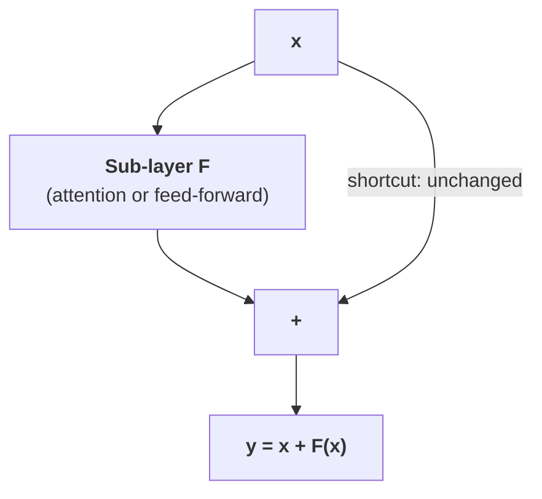
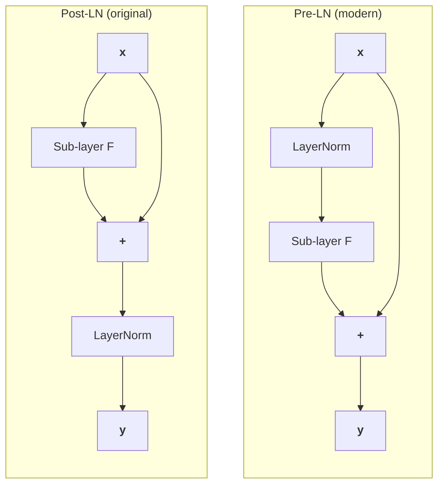

# Part VII — Residuals and normalization

**Why do these two extras appear around every sub-layer?** A transformer stacks dozens of layers, and a deep stack is hard to train for two reasons. The learning signal has to travel back through every layer, and it can fade on the way. The numbers flowing forward can also drift in scale from layer to layer. A residual connection addresses the first problem and normalization addresses the second. Neither adds new computation; both make the attention and feed-forward sub-layers trainable at depth.

## 29. Residual connections

Every sub-layer (attention or feed-forward) is wrapped in a residual connection: its input is added to its output. If $F$ is the sub-layer and $\mathbf{x}$ its input, the block computes

$$\mathbf{y} = \mathbf{x} + F(\mathbf{x})$$

The idea comes from [He et al. (2015)](./14-appendix-a-further-reading.md#he-et-al-2015), who found that very deep image networks became easier to optimize when each layer learned a *residual* $F(\mathbf{x})$ to add to its input instead of a whole new representation. The original transformer paper cites that work, and it notes that the model dimension is fixed at 512 throughout "to facilitate these residual connections" ([Vaswani et al., 2017](./14-appendix-a-further-reading.md#vaswani-et-al-2017)): the addition only works if $F(\mathbf{x})$ and $\mathbf{x}$ have the same shape.

### Why it helps: the gradient

Training sends a gradient from the loss back through the layers. For one residual block, the chain rule gives

$$\frac{\partial L}{\partial \mathbf{x}} = \frac{\partial L}{\partial \mathbf{y}}\left(\mathbf{I} + \frac{\partial F(\mathbf{x})}{\partial \mathbf{x}}\right)$$

where $\mathbf{I}$ is the identity matrix. The identity term is the point: even if $\partial F/\partial \mathbf{x}$ is tiny, the gradient reaches $\mathbf{x}$ through the shortcut without passing through any weights. [He et al. (2016)](./14-appendix-a-further-reading.md#he-et-al-2016) show that across many stacked blocks this direct path survives, so the gradient of a layer "does not vanish even when the weights are arbitrarily small".

A one-number toy makes the contrast concrete. Suppose each of 100 layers scales the gradient by only 0.01. Without shortcuts, the gradient at the bottom is the product of 100 such factors, $0.01^{100} = 10^{-200}$: nothing reaches the early layers. With shortcuts, each layer scales it by $1 + 0.01$, and the product is $1.01^{100} \approx 2.7$: the signal arrives intact. (Real layers are matrices, not single numbers, so this is only an illustration.)

A shortcut does not by itself stop gradients from growing too large: nothing in the equation bounds the $F$ term. Controlling scale is the job of normalization, which the rest of this part covers. And without shortcuts, a deep stack is not impossible to train, only much harder.

### The residual stream

Because every layer adds to its input instead of replacing it, the matrix flowing through the network, $n \times d_{\text{model}}$, is never overwritten. Each layer reads from it, computes a contribution, and writes the contribution back by addition. This is the *residual stream* from Part I, a view developed by [Elhage et al. (2021)](./14-appendix-a-further-reading.md#elhage-et-al-2021), who describe layers as reading from and writing to a shared stream.

## 30. Layer normalization

Layer normalization (LayerNorm), introduced by [Ba, Kiros and Hinton (2016)](./14-appendix-a-further-reading.md#ba-et-al-2016), controls the *scale* of what flows through the network. It is applied to each token's vector separately. For $\mathbf{x} \in \mathbb{R}^{d}$:

$$\mu = \frac{1}{d}\sum_{i=1}^{d} x_i, \qquad \sigma^2 = \frac{1}{d}\sum_{i=1}^{d} (x_i - \mu)^2, \qquad \operatorname{LayerNorm}(\mathbf{x})_i = \gamma_i \cdot \frac{x_i - \mu}{\sqrt{\sigma^2 + \epsilon}} + \beta_i$$

where $\boldsymbol{\gamma}, \boldsymbol{\beta} \in \mathbb{R}^d$ are learned scale and shift parameters and $\epsilon$ is a tiny constant (PyTorch uses $10^{-5}$) that avoids dividing by zero. It reads in three steps:

- **Recenter:** subtract the mean $\mu$ of the vector's own entries, so the result has mean 0.
- **Rescale:** divide by the standard deviation $\sqrt{\sigma^2 + \epsilon}$, so the result has variance close to 1.
- **Affine transform:** multiply by $\boldsymbol{\gamma}$ and add $\boldsymbol{\beta}$, which lets the model undo the normalization wherever that helps.

### A worked example

Take a four-dimensional vector $\mathbf{x} = (2, -1, 0, 5)$, with $\boldsymbol{\gamma} = \mathbf{1}$ and $\boldsymbol{\beta} = \mathbf{0}$:

$$\mu = \frac{2 - 1 + 0 + 5}{4} = 1.5, \qquad \sigma^2 = \frac{0.5^2 + 2.5^2 + 1.5^2 + 3.5^2}{4} = 5.25, \qquad \sqrt{\sigma^2 + \epsilon} \approx 2.291$$

$$\operatorname{LayerNorm}(\mathbf{x}) \approx \left(\frac{0.5}{2.291},\ \frac{-2.5}{2.291},\ \frac{-1.5}{2.291},\ \frac{3.5}{2.291}\right) \approx (0.218,\ -1.091,\ -0.655,\ 1.528)$$

The output has mean 0 and variance about 1, whatever the scale of the input: multiply $\mathbf{x}$ by 100 and the result is the same.

### On a whole sequence

For a matrix $\mathbf{X} \in \mathbb{R}^{n \times d}$, LayerNorm normalizes each row independently: the mean and variance are computed per token, but the same $\boldsymbol{\gamma}$ and $\boldsymbol{\beta}$ are used for every row.

> **Note.** Batch normalization, common in image networks, computes its statistics across the batch instead. Ba et al. argue that its effect depends on the mini-batch size and is awkward for recurrent models. LayerNorm uses only the features of one token, so it behaves the same for any batch size or sequence length.

LayerNorm adds only $2\,d_{\text{model}}$ parameters per instance (one $\gamma$ and one $\beta$ per feature), a negligible fraction of a large model.

## 31. RMSNorm

[Zhang and Sennrich (2019)](./14-appendix-a-further-reading.md#zhang-and-sennrich-2019) hypothesized that the recentering step of LayerNorm contributes little and that the rescaling does the useful work. Their Root Mean Square normalization (RMSNorm) drops the mean subtraction and the shift:

$$\operatorname{RMS}(\mathbf{x}) = \sqrt{\frac{1}{d}\sum_{i=1}^{d} x_i^2}, \qquad \operatorname{RMSNorm}(\mathbf{x})_i = \gamma_i \cdot \frac{x_i}{\operatorname{RMS}(\mathbf{x})}$$

Implementations put the small constant $\epsilon$ inside the square root, $\sqrt{\frac{1}{d}\sum x_i^2 + \epsilon}$, so the division is safe when the vector is all zeros. On the same example, $\operatorname{RMS}(\mathbf{x}) = \sqrt{(4 + 1 + 0 + 25)/4} = \sqrt{7.5} \approx 2.739$, so

$$\operatorname{RMSNorm}(\mathbf{x}) \approx (0.730,\ -0.365,\ 0,\ 1.826)$$

The output is not centred (its mean is not 0), but its overall scale is fixed. If a vector already has mean 0, then $\sigma^2 = \operatorname{RMS}(\mathbf{x})^2$ and the two give the same result up to $\boldsymbol{\beta}$.

RMSNorm is cheaper (no mean, no shift parameter), and the authors report running-time savings of 7% to 64% depending on the model, with about 7% to 9% for the Transformer they tested. Llama uses it ([Touvron et al., 2023](./14-appendix-a-further-reading.md#touvron-et-al-2023)), as do Gemma 2 and OLMo 2 (see below).

A norm layer with only $\boldsymbol{\gamma}$ has $d_{\text{model}}$ parameters. Llama 2 7B has two RMSNorm layers in each of its 32 blocks and one more before the output, so $(2 \times 32 + 1) \times 4096 = 266{,}240$ parameters: about 0.004% of 7 billion.

## 32. Pre-LN versus Post-LN

There are two places to put the normalization in a residual block. The original transformer used *post-norm*, after the residual addition ([Vaswani et al., 2017](./14-appendix-a-further-reading.md#vaswani-et-al-2017)):

$$\text{Post-LN:}\quad \mathbf{y} = \operatorname{LayerNorm}\big(\mathbf{x} + F(\mathbf{x})\big)$$

*Pre-norm* moves it inside the branch, before the sub-layer:

$$\text{Pre-LN:}\quad \mathbf{y} = \mathbf{x} + F\big(\operatorname{LayerNorm}(\mathbf{x})\big)$$

[Xiong et al. (2020)](./14-appendix-a-further-reading.md#xiong-et-al-2020) found that at initialization the expected gradients near the output of a Post-LN transformer are large, which is why it needs a careful learning-rate warmup. With Pre-LN the gradients are well behaved at initialization, and they showed that the warmup stage can be removed.

Pre-LN is not free. The residual path is never renormalized, so the stream accumulates every layer's contribution and its variance grows with depth; [Sun et al. (2025)](./14-appendix-a-further-reading.md#sun-et-al-2025) argue that in very deep Pre-LN models this makes the deepest layers contribute little. Most recent open models use pre-norm, with variants: Gemma 2 normalizes both the input and the output of each sub-layer ([Gemma Team, 2024](./14-appendix-a-further-reading.md#gemma-team-2024-gemma-2)), and OLMo 2 normalizes the outputs of attention and the feed-forward network ([OLMo Team, 2025](./14-appendix-a-further-reading.md#olmo-team-2025)).

Llama and many models since combine the choices of Parts VI and VII: each block computes $\mathbf{x} \leftarrow \mathbf{x} + \operatorname{Attention}(\operatorname{RMSNorm}(\mathbf{x}))$ and then $\mathbf{x} \leftarrow \mathbf{x} + \operatorname{FFN}_{\text{SwiGLU}}(\operatorname{RMSNorm}(\mathbf{x}))$, with RoPE inside attention and often GQA.
