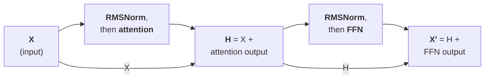

# Part VIII — The full transformer block

**What is a transformer block, and why stack it?** Each earlier part added one piece. Attention moves information between tokens, the feed-forward network processes each token, and residual connections and normalization keep the stack trainable. A *block* is those pieces wired together, and the whole model is the same block repeated. This part draws the block, counts what is in it, and follows the data through the whole network.

## 33. Assembling the block

A modern decoder block, the form used by Llama and many models since, takes an $n \times d_{\text{model}}$ matrix $\mathbf{X}$ and contains:

- multi-head attention, with RoPE on the queries and keys and the causal mask;
- a feed-forward network (Part VI), typically SwiGLU;
- a residual connection around each of the two sub-layers (Part VII);
- normalization (RMSNorm or LayerNorm) before each sub-layer, the pre-norm position (Part VII).

With $\mathbf{X}$ the input to block $\ell$, the two sub-layers are

$$\mathbf{H} = \mathbf{X} + \operatorname{MultiHead}\big(\operatorname{RMSNorm}(\mathbf{X})\big), \qquad \mathbf{X}' = \mathbf{H} + \operatorname{FFN}_{\text{SwiGLU}}\big(\operatorname{RMSNorm}(\mathbf{H})\big)$$

Normalization and the feed-forward network act on each row (token) independently, so the single-vector formulas of Parts VI and VII apply row by row. The output $\mathbf{X}'$ becomes the input of block $\ell + 1$. The shape $n \times d_{\text{model}}$ is the same at every point along the shortcuts and at the input and output of the block. Nothing narrows or widens between blocks; only inside the feed-forward network does the width change, and it returns to $d_{\text{model}}$ before the addition. The figure shows the data path.

## 34. Stacking blocks

The full model is $L$ blocks in sequence. The weights are not shared: each block has its own matrices and norm parameters. Real models differ in how many blocks they stack and how wide they are:

::: grid
| Model | $L$ | $d_{\text{model}}$ | $h$ | $d_{\text{ff}}$ | Parameters |
|---|---|---|---|---|---|
| Original Transformer, base | 6 | 512 | 8 | 2048 | 65M |
| GPT-2 small | 12 | 768 | 12 | 3072 | 124M |
| GPT-2 XL | 48 | 1600 | 25 | 6400 | about 1.5B |
| GPT-3 | 96 | 12288 | 96 | 49152 | 175B |
| Llama 2 7B | 32 | 4096 | 32 | 11008 | 6.7B |
| Llama 2 70B | 80 | 8192 | 64 (8 KV) | 28672 | 70B |
:::

Sources: [Vaswani et al. (2017)](./14-appendix-a-further-reading.md#vaswani-et-al-2017) (6 layers in each of its encoder and decoder), [Radford et al. (2019)](./14-appendix-a-further-reading.md#radford-et-al-2019), [Brown et al. (2020)](./14-appendix-a-further-reading.md#brown-et-al-2020) and the [published configurations](./14-appendix-a-further-reading.md#llama-2-configurations) for Llama 2. GPT-2 small is listed as 117M in its paper, a count OpenAI later said was wrong ([OpenAI repository](./14-appendix-a-further-reading.md#openai-gpt-2-repository)); where $d_{\text{ff}}$ is not printed, it is the usual $4\,d_{\text{model}}$.

A model has about $12\,L\,d_{\text{model}}^2$ weights in its blocks (Parts IV and VI): linear in depth, quadratic in width. [Kaplan et al. (2020)](./14-appendix-a-further-reading.md#kaplan-et-al-2020) found that, for a given number of parameters, the loss depends only very weakly on how they are split between depth and width.

### From tokens to logits: the shapes

Following one sequence of $n$ tokens through the whole model, with vocabulary size $V$:

::: grid
| Stage | Shape |
|---|---|
| Token IDs | $n$ |
| Embedding lookup (Part II) | $n \times d_{\text{model}}$ |
| Each of the $L$ blocks (Part VIII) | $n \times d_{\text{model}}$ (unchanged) |
| Final norm, then unembedding $\mathbf{U}$ (Part IX) | $n \times V$ (logits) |
| Softmax over each row (Part IX) | $n \times V$ (probabilities) |
:::

In a decoder-only model, row $i$ of the logits is the model's prediction for token $i + 1$.

## 35. Parameter budget for a real model

Llama 2 7B has $L = 32$ blocks, $d_{\text{model}} = 4096$, $h = 32$ heads with standard multi-head attention, $d_{\text{ff}} = 11008$ and $V = 32000$. Its embedding and output matrices are not tied. Counting every weight:

::: grid
| Component | Formula | Count |
|---|---|---|
| Attention ($\mathbf{W}_Q, \mathbf{W}_K, \mathbf{W}_V, \mathbf{W}_O$) | $4 \cdot 4096^2$ | 67.1M |
| Feed-forward ($\mathbf{W}_1, \mathbf{W}_2, \mathbf{W}_3$) | $3 \cdot 4096 \cdot 11008$ | 135.3M |
| Two RMSNorms ($\gamma$ only) | $2 \cdot 4096$ | 8,192 |
| **One block** | | **202,383,360** |
| 32 blocks | $32 \cdot 202{,}383{,}360$ | 6,476,267,520 |
| Token embedding | $32000 \cdot 4096$ | 131,072,000 |
| Output projection | $4096 \cdot 32000$ | 131,072,000 |
| Final RMSNorm | $4096$ | 4,096 |
| **Total** | | **6,738,415,616** |
:::

The total matches the published configuration exactly. Three things stand out:

- **The blocks hold 96% of the parameters**; the embedding and output projection together are under 4%.
- **Within a block, the feed-forward network holds about 67%** (135.3M of 202.4M) and attention about 33%, as Part VI worked out.
- **Normalization is almost free**: 266,240 parameters in all, about 0.004% of the total.
