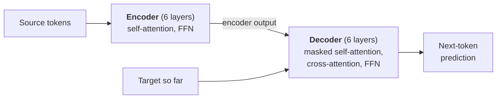

# Part X — Encoder and decoder families

**Why are there different transformer families, and how do they differ?** Parts III to IX built a decoder-only model. The original transformer was designed for translation: read a whole source sentence, then write the target sentence. That job suits two halves, and the families differ in what each position may see and in how input and output are connected.

## 39. The original encoder–decoder design

Translation has an input that is fully known in advance and an output that must be produced one token at a time, so the original transformer gives each its own stack ([Vaswani et al., 2017](./14-appendix-a-further-reading.md#vaswani-et-al-2017)):

- The **encoder** reads the source sentence in parallel and produces a contextual representation of every source token. It has 6 layers, each with self-attention (no causal mask, so every source token sees every other) and a feed-forward network.
- The **decoder** generates the target one token at a time. It also has 6 layers, each with three sub-layers: masked self-attention over the target so far, *cross-attention* to the encoder's output, and a feed-forward network.

A decoder-only block (Part VIII) is this decoder layer without the cross-attention sub-layer. The figure shows how the two stacks connect.

## 40. Cross-attention in detail

The decoder has to use the source sentence, and cross-attention is the one place where it does. It is the attention of Part III, with a different origin for each matrix: the queries come from the decoder, and the keys and values come from the output of the encoder stack ([Vaswani et al., 2017](./14-appendix-a-further-reading.md#vaswani-et-al-2017)). With $\mathbf{H}$ the decoder's hidden state at that layer ($n_{\text{tgt}} \times d_{\text{model}}$) and $\mathbf{Z}$ the final encoder output ($n_{\text{src}} \times d_{\text{model}}$):

$$\mathbf{Q} = \mathbf{H}\,\mathbf{W}_Q, \qquad \mathbf{K} = \mathbf{Z}\,\mathbf{W}_K, \qquad \mathbf{V} = \mathbf{Z}\,\mathbf{W}_V$$

The query matrix has one row per target token and the key and value matrices one row per source token, so the score matrix $\mathbf{Q}\mathbf{K}^\top$ is $n_{\text{tgt}} \times n_{\text{src}}$: rectangular, with a row per target position and a column per source position. There is no causal mask, because the whole source is given; the constraint against seeing the future applies only to the target, and the decoder's self-attention already enforces it.

To see this with numbers, take the three source tokens of Part III as the encoder output, so $\mathbf{K}$ and $\mathbf{V}$ are the matrices from there. Suppose the decoder has produced two target tokens, and, as a shortcut, give them the first two rows of $\mathbf{Q}$ from Part III as queries (in a real model they are computed from $\mathbf{H}$). The weights, scaled and softmaxed as in Part III, form a $2 \times 3$ matrix:

$$\mathbf{A} \approx \begin{bmatrix}
0.322 & 0.350 & 0.328 \\
0.334 & 0.361 & 0.305
\end{bmatrix}$$

Each row is one target position's distribution over the three source positions. Unlike the causal case in Part V, nothing is masked: the first target token may draw on all three source tokens. The source does not change while the target is generated, so the keys and values can be computed once per layer and reused at every decoding step ([Hugging Face, KV cache](./14-appendix-a-further-reading.md#hugging-face-kv-cache)).

## 41. Encoder-only, decoder-only and encoder–decoder

The right design depends on the task, so each half of the original can be used alone or together:

- **Encoder-only** models use bidirectional attention and suit tasks that read a whole input, such as classification and embeddings ([BERT](./14-appendix-a-further-reading.md#devlin-et-al-2019)).
- **Decoder-only** models use causal attention and generate text ([GPT-2](./14-appendix-a-further-reading.md#radford-et-al-2019), [GPT-3](./14-appendix-a-further-reading.md#brown-et-al-2020), [Llama](./14-appendix-a-further-reading.md#touvron-et-al-2023-llama-2)).
- **Encoder–decoder** models pair a bidirectional encoder with a causal decoder and cross-attention, for tasks such as translation and speech to text ([T5](./14-appendix-a-further-reading.md#raffel-et-al-2020), [BART](./14-appendix-a-further-reading.md#lewis-et-al-2019), [Whisper](./14-appendix-a-further-reading.md#radford-et-al-2022)).

The families are also trained differently: BERT predicts masked tokens, T5 and BART reconstruct corrupted text, and decoder-only models predict the next token.

Decoder-only models became the dominant architecture for general-purpose language models. [Brown et al. (2020)](./14-appendix-a-further-reading.md#brown-et-al-2020) showed that one large decoder-only model can perform many tasks from a prompt, with no fine-tuning, and the architecture is the simplest of the three: no encoder and no cross-attention. Controlled comparisons are mixed, though. At about 5 billion parameters, a causal decoder-only model trained for next-token prediction gave the best zero-shot results without fine-tuning, while a model with bidirectional input visibility, trained with masked language modelling and then fine-tuned on many tasks, did best overall ([Wang et al., 2022](./14-appendix-a-further-reading.md#wang-et-al-2022)). The other two families have not disappeared: Whisper, for example, is an encoder–decoder model for speech recognition.
